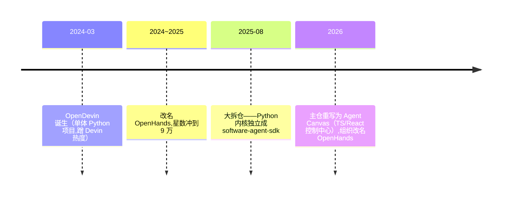

# 🦾 OpenHands 源码解读（前 OpenDevin·双仓版·2026-10-11 入库）

> 源码：`OpenHands/`（主仓 main 快照 2026-10-11，**90.5k★**，TS/React）+ `software-agent-sdk/`（Python 内核仓，1.2k★，v1.54.0，29MB）双仓均已浅克隆入库。**⚠️ 认知纠偏**：OpenHands 已不是 2024 年那个"单体 Python 项目 OpenDevin"——2025-08 拆仓后，主仓变成 **Agent Canvas**（TS/React 的自托管 Agent 控制中心），真正的 Python agent 内核搬进了 `software-agent-sdk`。组织已从 All-Hands-AI 改名 OpenHands。📱 图解版：[OpenHands解读.html](OpenHands解读.html)。

## 🎯 一句话

开源版 Devin（AI 软件工程师）演化成的"**Python agent 内核 SDK + 万能 Agent 控制台**"双仓体系——上一轮"ZCode 能否用 Python 重写"的**活证据**：它就是用 Python 写的那个 coding agent，SWE-Bench 77.6。

## 📜 演变时间线（架构判断力教材）



拆仓逻辑 = **单体应用 → 内核（SDK）/界面（Canvas）分离**：内核只管"对话循环+工具"，界面只管"渲染+调度"，中间靠 Agent Server HTTP API + ACP 协议连接。这正是 ZCode"apps/zcode-cli 引擎 + desktop/web 三张皮"的另一种解法，面试讲架构演进的好案例。

## 🗺️ 双仓目录地图（数仓分层翻译）

| 目录 | 是什么 | 数仓类比 |
|------|--------|----------|
| **SDK 仓 `openhands-sdk/`** | 内核：conversation 主循环 + agent + llm + event + mcp | ETL 主调度 |
| → `sdk/conversation/impl/local_conversation.py` | **Agent 主循环**（while True: agent.step()） | 调度的 while 轮询 |
| → `sdk/agent/agent.py:694` | step()：压缩上下文→调 LLM→并行执行工具 | 单次作业编排 |
| → `sdk/llm/` | litellm 封装（多模型路由/重试/fallback） | JDBC 多数据源 |
| → `sdk/event/` | 全 pydantic 类型化事件流（可落盘回放=事件溯源） | CDC 日志 |
| → `sdk/mcp/` | MCP 接入（**fastmcp——DGA 同款**） | 外部数据源接入 |
| **`openhands-tools/`** | 内置工具包：terminal/file_editor/glob/grep/delegate(子代理)/browser_use/planning_file_editor/workflow | UDF 工具箱 |
| **`openhands-agent-server/`** | FastAPI 把 SDK 暴露成 HTTP Agent Server | 数据服务 API 层 |
| **`openhands-workspace/`** | 沙箱分级：local/docker/cloud/remote_api | 开发/测试/生产环境隔离 |
| **主仓 `src/`（Agent Canvas）** | React 19+Vite+Zustand 控制台：对话/终端/文件/自动化 UI | BI 报表层 |
| → `src/api/acp-service/` | **ACP 协议**接第三方 agent（Claude Code/Codex/Gemini/OpenCode） | 多引擎适配器 |

## ⚙️ 内核精读：20 行跑起一个 Agent

SDK 官方 hello world（`examples/01_standalone_sdk/01_hello_world.py`）——这就是"300 行迷你内核"的官方极简版：

```python
from openhands.sdk import LLM, Agent, Conversation, Tool
from openhands.tools.file_editor import FileEditorTool
from openhands.tools.terminal import TerminalTool

llm = LLM(model="gpt-5.5", api_key=...)
agent = Agent(llm=llm, tools=[Tool(name=TerminalTool.name), Tool(name=FileEditorTool.name)])
conversation = Conversation(agent=agent, workspace=os.getcwd())
conversation.send_message("把当前项目的 3 个事实写进 FACTS.txt")
conversation.run()   # ← 主循环在这里
```

主循环解剖（`local_conversation.py` `_run()`）：

1. `while True: agent.step()` + **状态机**（RUNNING/PAUSED/STUCK/WAITING_FOR_CONFIRMATION/FINISHED/ERROR）
2. 每轮兜底：卡死检测 stuck_detector / 最大迭代 / 预算超限 / 确认模式暂停
3. `step()` 内部：待确认动作先执行 → hook 检查 → **condenser 上下文压缩**（≈ZCode compact-session）→ `llm.generate(tools=...)` → 解析 function calls → **ParallelToolExecutor 并行执行** → Observation 事件回填

## 💎 依赖表：上轮预测的全部验证（10.11 会话）

| ZCode 用什么 | OpenHands SDK 对应物 | 预测命中 |
|---|---|---|
| Vercel AI SDK v6 | **litellm** | ✅ |
| zod 4 | **pydantic** | ✅ |
| 自研 MCP 接入 | **fastmcp**（DGA 同款） | ✅ |
| .agents/skills SKILL.md | **SKILL.md+frontmatter，兼容 Claude Code 格式** | ✅ |
| 自研工具注册表 | pydantic `ToolDefinition`+`register_tool` | ✅ |
| compact-session 压缩 | condenser | ✅ |
| approval 审批门 | confirmation mode（WAITING_FOR_CONFIRMATION） | ✅ |
| 无独立沙箱强调 | workspace 四级沙箱（local/docker/cloud/remote） | OpenHands 更重 |

两家的 skills 机制完全同构（SKILL.md + frontmatter），OpenHands 甚至直接写了 `claude_code.py` 格式适配器来兼容 Claude Code 技能——**技能生态已经事实标准化**。

## 💰 三层价值

1. **Python 写 agent 的可行性定版**：78k 行工业级 Python agent 内核，依赖栈与 DGA 高度重合——"Python 重写 ZCode 内核"从推测变成有参照实现
2. **DGA 可抄点**：事件溯源落盘（审计）、confirmation mode（审批门）、condenser（长对话压缩）、parallel executor（并行工具）
3. **求职叙事**：OpenDevin→拆仓演进 = "内核/界面分离"架构判断案例；90.5k★ 项目源码通读本身就是谈资

## 🔍 精读路线（配合三线计划）

hello world → `local_conversation.py` 主循环 → `agent.py` step → `openhands-tools/terminal`（工具定义范式）→ `sdk/mcp/client.py` → workspace 沙箱 → 主仓 `acp-service`（多 agent 接入）

## 🌍 本地跑

SDK 仓用 uv：`pip install openhands-sdk`（或 `uv sync`）；主仓 Agent Canvas：`npm run dev`（会经 uvx 拉起 agent-server + Vite 前端 + ingress 代理）。另有论文 arXiv:2511.03690。

## 🔗 关联

[[ZCode解读]] · [[OpenCode解读]] · [[Agent源码研究五线对比]] · [[开源数据治理Agent-DGA-总体方案-v0.1]]
